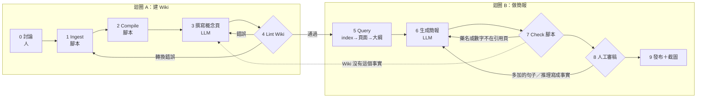

# 臺灣常用藥物 LLM Wiki

以作者自己整理的《臺灣常用藥物講義》12 篇為來源，建立一個互相連結、可查詢、可檢查的 LLM Wiki，
再只用 Wiki 的內容產生一份給初學者的教學 HTML 簡報〈自律神經藥物入門：從受體推出藥效〉。

- 網站：**https://joselan4288.github.io/drug-llm-wiki/**
- 教學簡報：https://joselan4288.github.io/drug-llm-wiki/slides/
- Wiki：https://joselan4288.github.io/drug-llm-wiki/wiki.html#index
- Schema（AI 規則）：[`CLAUDE.md`](CLAUDE.md)

## 三層架構

| 層 | 內容 | 數量 |
| --- | --- | --- |
| `raw/` | 從 Claude Docs 匯入的原始講義（不可手改） | 12 篇、189 張表格 |
| `wiki/` | 概念頁（AI 撰寫）、類別頁與彙整頁（腳本）、index、log | 13 + 83 + 3 + 2 頁 |
| `slides/` | 教學 HTML 簡報，每張標示引用的 Wiki 頁 | 16 張 |

## Loop／Graph



| 腳本 | 作用 |
| --- | --- |
| `scripts/ingest_docs.py` | Claude Docs 分頁的 XML → `raw/*.md` |
| `scripts/compile_wiki.py` | 產生類別頁、跨篇藥名索引、字尾總表、情境總表、`wiki/index.md` |
| `scripts/lint_wiki.py` | L1–L8 錯誤（斷連結、孤兒頁、缺來源、藥名／數字不在引用章節…）、W9 警告 |
| `scripts/check_slides.py` | S1–S5 錯誤（引用頁不存在、藥名／數字不在引用頁…）、W6 警告 |

## 實際執行紀錄與反思

- 完整紀錄：[`logs/run-2026-11-17.md`](logs/run-2026-11-17.md)
- 各輪檢查輸出：`logs/lint-run*.txt`、`logs/check-slides-run*.txt`
- 大綱（query 輸出）：[`logs/query-outline.md`](logs/query-outline.md)
- 反思：見網站首頁「反思」一節

## 本機執行

```bash
python3 scripts/compile_wiki.py
python3 scripts/lint_wiki.py
python3 scripts/check_slides.py
python3 -m http.server 8000   # 開 http://localhost:8000
```

內容僅供學習，不構成醫療建議；實際用藥以醫師處方與最新仿單為準。
